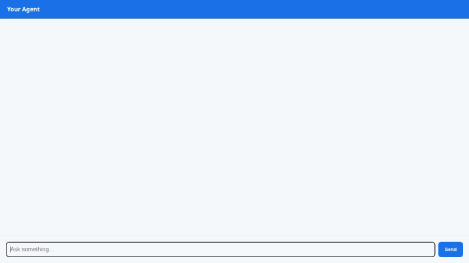

# TV Series Admin Agent

An intelligent, interactive AI agent for managing TV series catalogs, querying show metadata, calculating binge statistics, and retrieving real-world series information. Built with Google ADK (Agent Development Kit), Gemini 2.5 Flash, and A2UI (Agent-to-User Interface) for rich card rendering.



---

## Capabilities & Architecture

Based directly on the codebase in `app/` and `agents-cli-manifest.yaml`, the agent implements the following features and integrations:

### 1. Google Cloud Services & Integrations
- **Google Cloud Firestore**: Persists TV series documents and episode subcollections (`series/{series_id}/episodes`).
- **Agent Engine Sandbox Code Executor**: Executes custom Python code in a isolated sandbox environment.
- **Vertex AI Agent Runtime**: Deployed as a managed Agent Engine reasoning engine using the A2A (Agent-to-Agent) protocol.
- **FastAPI Proxy & Cloud Run**: Lightweight FastAPI middleware proxy that routes browser chat requests to the deployed agent over A2A and serves the chat UI.

### 2. Built-in Agent Tools (`app/agent.py`)
- `search_series`: Queries Firestore to filter series by title, genre, network, or production status (`Airing`, `Renewed`, `In Production`, `Cancelled`).
- `update_series_info`: Modifies fields (`title`, `status`, `summary`, `seasons`, `episodes_count`, `rating`) on existing Firestore show documents.
- `add_series`: Adds new TV series records into the Firestore database.
- `add_episode`: Appends new episode documents to a series' `episodes` subcollection in Firestore and updates the episode count.
- `calculate_show_stats`: Computes total binge runtime (hours/days), average episodes per season, and budget estimates.
- `fetch_external_show_info`: Integrates with the public TVMaze API to retrieve real-world show details (genres, premier date, network, rating, and poster images).

### 3. A2UI Visual Cards
- Uses `A2uiSchemaManager` (v0.8) and `BasicCatalog` with an `after_model_callback` (`a2ui_callback`) to transform structured model outputs into interactive UI cards rendered natively in the chat interface.

---

## Local Setup & Run Instructions

### Prerequisites
- Python 3.11+
- Google Cloud SDK (`gcloud`) authenticated with Application Default Credentials (`gcloud auth application-default login`)
- GCP Project with Firestore enabled

### 1. Install Dependencies
```bash
# Install agent dependencies
pip install -r app/requirements.txt

# Install frontend proxy dependencies
pip install -r frontend/requirements.txt
```

### 2. Run Agent Playground Locally
To launch the interactive ADK playground locally:
```bash
agents-cli playground
```

### 3. Run Frontend Proxy & Chat UI Locally
Set the target agent engine resource name and start the FastAPI proxy:
```bash
export AGENT_ENGINE_RESOURCE_NAME="projects/<PROJECT_ID>/locations/<REGION>/reasoningEngines/<ENGINE_ID>"
export AGENT_DIRECTORY="app"

python frontend/main.py
```
Then navigate to your local web browser port to interact with the chat UI.

---

## Project Structure

```
.
├── app/
│   ├── agent.py          # Main ADK agent definition, Gemini model setup, and Firestore tools
│   ├── a2ui_utils.py     # A2UI callback and schema manager integration
│   ├── fast_api_app.py   # FastAPI wrapper for local execution
│   └── requirements.txt  # Agent dependencies
├── frontend/
│   ├── main.py           # FastAPI proxy forwarding A2A requests to Agent Engine
│   ├── Dockerfile        # Container build definition for Cloud Run
│   ├── requirements.txt  # Proxy dependencies
│   └── static/
│       └── index.html    # Lightweight chat UI with built-in A2UI mini-renderer
├── agents-cli-manifest.yaml # Deployment and framework configuration
├── demo.gif              # Loop demonstration recording of the agent UI
└── README.md             # Project documentation
```
